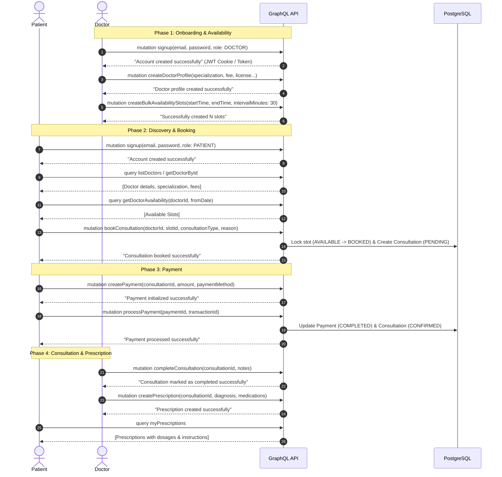

# Amrutam - Telemedicine & Doctor Booking GraphQL API

A robust, enterprise-grade Telemedicine and Doctor Consultation Backend built with **NestJS**, **GraphQL (Apollo Server Code-First)**, **TypeORM**, and **PostgreSQL**.

---

## 📑 Table of Contents

- [Overview](#overview)
- [Architecture & Tech Stack](#architecture--tech-stack)
- [End-to-End API Flow](#end-to-end-api-flow)
  - [1. Authentication & Onboarding](#1-authentication--onboarding)
  - [2. Doctor Availability Slots](#2-doctor-availability-slots)
  - [3. Consultation Booking](#3-consultation-booking)
  - [4. Payment Processing](#4-payment-processing)
  - [5. Consultation Completion & Prescription](#5-consultation-completion--prescription)
- [GraphQL Operations Reference](#graphql-operations-reference)
  - [Auth Operations](#auth-operations)
  - [Doctor Operations](#doctor-operations)
  - [Availability Slot Operations](#availability-slot-operations)
  - [Consultation Operations](#consultation-operations)
  - [Prescription Operations](#prescription-operations)
  - [Payment Operations](#payment-operations)
- [Authentication & Security](#authentication--security)
- [Environment Configuration](#environment-configuration)
- [Getting Started](#getting-started)
- [Testing & Tooling](#testing--tooling)

---

## Overview

Amrutam API is designed for a complete telemedicine workflow connecting patients with verified medical specialists. Key capabilities include:
- **Role-based access** for Patients, Doctors, and Administrators.
- **Availability slot management** with single and bulk slot generation and overlap collision prevention.
- **Slot reservation & consultation booking** with status progression (`PENDING`, `CONFIRMED`, `COMPLETED`, `CANCELLED`, `RESCHEDULED`).
- **Payment processing & refunds** tied directly to consultations.
- **Digital prescriptions** with structured medication dosage, frequency, and instructions.
- **Clean GraphQL contract**: Action mutations return lightweight status strings (`String`) to optimize performance, while queries return rich entity graphs resolved on-demand.

---

## Architecture & Tech Stack

- **Framework**: [NestJS](https://nestjs.com/) (v12)
- **API Paradigm**: Code-First GraphQL via [@nestjs/graphql](https://docs.nestjs.com/graphql/quick-start) & [@nestjs/apollo](https://docs.nestjs.com/graphql/quick-start)
- **Database ORM**: [TypeORM](https://typeorm.io/) with PostgreSQL
- **Authentication**: JWT (JSON Web Tokens) with dual-mode support:
  - `Authorization: Bearer <token>` header
  - `jwt_access_token` HTTP-only, secure cookies
- **Validation & Transformation**: `class-validator` & `class-transformer`
- **Security**: `helmet`, `cors`, `bcrypt` password hashing, global `PublicApiGuard`

---

## End-to-End API Flow



---

## GraphQL Operations Reference

All GraphQL operations are accessible at `/graphql`.

### Auth Operations

| Type | Operation | Access | Description |
|---|---|---|---|
| `Mutation` | `signup(input: SignupDto!): String!` | Public | Creates a new user and profile; sets JWT cookie; returns success message. |
| `Mutation` | `login(input: LoginDto!): String!` | Public | Validates credentials; sets JWT cookie; returns success message. |
| `Mutation` | `logout: String!` | Protected | Clears JWT authentication cookies. |
| `Query` | `me: UserEntity!` | Protected | Returns the authenticated user's profile and account status. |

```graphql
# Example: User Signup
mutation Signup($input: SignupDto!) {
  signup(input: $input)
}

# Example: Login
mutation Login($input: LoginDto!) {
  login(input: $input)
}

# Example: Get Authenticated Profile
query Me {
  me {
    user_id
    email
    role
    status
    profile {
      full_name
      phone
      gender
      date_of_birth
    }
  }
}
```

---

### Doctor Operations

| Type | Operation | Access | Description |
|---|---|---|---|
| `Mutation` | `createDoctorProfile(input: CreateDoctorDto!): String!` | DOCTOR | Creates medical profile (license, specialization, consultation fee). |
| `Mutation` | `updateDoctorProfile(input: UpdateDoctorDto!): String!` | DOCTOR | Updates doctor profile information. |
| `Query` | `myDoctorProfile: DoctorEntity!` | DOCTOR | Retrieves the logged-in doctor's profile. |
| `Query` | `getDoctorById(doctorId: ID!): DoctorEntity!` | Public | Retrieves specific doctor details by doctor ID. |
| `Query` | `listDoctors: [DoctorEntity!]!` | Public | Retrieves all registered doctors. |

```graphql
# Example: Create Doctor Profile
mutation CreateDoctorProfile($input: CreateDoctorDto!) {
  createDoctorProfile(input: $input)
}

# Example: List Doctors
query ListDoctors {
  listDoctors {
    doctor_id
    specialization
    experience_years
    consultation_fee
    verification_status
    bio
    user {
      profile {
        full_name
        profile_image_url
      }
    }
  }
}
```

---

### Availability Slot Operations

| Type | Operation | Access | Description |
|---|---|---|---|
| `Mutation` | `createAvailabilitySlot(input: CreateAvailabilitySlotDto!): String!` | DOCTOR | Creates a single availability slot. |
| `Mutation` | `createBulkAvailabilitySlots(input: BulkCreateSlotsDto!): String!` | DOCTOR | Generates multiple consecutive slots by interval minutes. |
| `Mutation` | `updateAvailabilitySlot(slotId: ID!, input: UpdateAvailabilitySlotDto!): String!` | DOCTOR | Updates slot time or status (`AVAILABLE`, `LOCKED`, etc.). |
| `Mutation` | `deleteAvailabilitySlot(slotId: ID!): String!` | DOCTOR | Deletes an unbooked availability slot. |
| `Query` | `getDoctorAvailability(doctorId: ID!, fromDate: DateTime): [AvailabilitySlotEntity!]!` | Public | Fetches available upcoming slots for a specific doctor. |
| `Query` | `myAvailabilitySlots: [AvailabilitySlotEntity!]!` | DOCTOR | Retrieves all slots created by the logged-in doctor. |
| `Query` | `getAvailabilitySlotById(slotId: ID!): AvailabilitySlotEntity!` | Protected | Fetches single slot by ID. |

```graphql
# Example: Bulk Create Slots (e.g. 30-min intervals)
mutation CreateBulkSlots($input: BulkCreateSlotsDto!) {
  createBulkAvailabilitySlots(input: $input)
}

# Example: Check Doctor Availability
query GetDoctorAvailability($doctorId: ID!, $fromDate: DateTime) {
  getDoctorAvailability(doctorId: $doctorId, fromDate: $fromDate) {
    slot_id
    start_time
    end_time
    status
  }
}
```

---

### Consultation Operations

| Type | Operation | Access | Description |
|---|---|---|---|
| `Mutation` | `bookConsultation(input: CreateConsultationDto!): String!` | PATIENT | Reserves slot and books consultation. |
| `Mutation` | `rescheduleConsultation(input: RescheduleConsultationDto!): String!` | Protected | Swaps to a new available slot and reschedules consultation. |
| `Mutation` | `cancelConsultation(consultationId: ID!, reason: String): String!` | Protected | Cancels consultation and releases slot back to `AVAILABLE`. |
| `Mutation` | `completeConsultation(consultationId: ID!, notes: String): String!` | DOCTOR | Marks consultation `COMPLETED` and saves consultation notes. |
| `Query` | `getConsultationById(consultationId: ID!): ConsultationEntity!` | Protected | Retrieves detailed consultation by ID. |
| `Query` | `myConsultations: [ConsultationEntity!]!` | Protected | Lists consultations for the current user (as patient or doctor). |

```graphql
# Example: Book Consultation
mutation BookConsultation($input: CreateConsultationDto!) {
  bookConsultation(input: $input)
}

# Example: Get My Consultations
query MyConsultations {
  myConsultations {
    consultation_id
    scheduled_at
    consultation_type
    status
    reason
    doctor {
      specialization
      user {
        profile {
          full_name
        }
      }
    }
  }
}
```

---

### Prescription Operations

| Type | Operation | Access | Description |
|---|---|---|---|
| `Mutation` | `createPrescription(input: CreatePrescriptionDto!): String!` | DOCTOR | Creates digital prescription for a consultation. |
| `Mutation` | `updatePrescription(prescriptionId: ID!, input: UpdatePrescriptionDto!): String!` | DOCTOR | Updates existing prescription details. |
| `Query` | `getPrescriptionById(prescriptionId: ID!): PrescriptionEntity!` | Protected | Retrieves prescription by ID. |
| `Query` | `getPrescriptionsByConsultation(consultationId: ID!): [PrescriptionEntity!]!` | Protected | Retrieves prescription for a given consultation. |
| `Query` | `myPrescriptions: [PrescriptionEntity!]!` | Protected | Returns all prescriptions for current user (patient or doctor). |

```graphql
# Example: Create Prescription
mutation CreatePrescription($input: CreatePrescriptionDto!) {
  createPrescription(input: $input)
}

# Example: View Prescriptions
query MyPrescriptions {
  myPrescriptions {
    prescription_id
    diagnosis
    notes
    medications {
      name
      dosage
      frequency
      duration
      instructions
    }
    created_at
  }
}
```

---

### Payment Operations

| Type | Operation | Access | Description |
|---|---|---|---|
| `Mutation` | `createPayment(input: CreatePaymentDto!): String!` | PATIENT | Initializes a payment record for a consultation. |
| `Mutation` | `processPayment(input: ProcessPaymentDto!): String!` | PATIENT | Completes payment transaction and confirms consultation. |
| `Mutation` | `refundPayment(paymentId: ID!): String!` | Protected | Marks payment refunded and updates records. |
| `Query` | `getPaymentById(paymentId: ID!): PaymentEntity!` | Protected | Fetches payment record by ID. |
| `Query` | `getPaymentsByConsultation(consultationId: ID!): [PaymentEntity!]!` | Protected | Fetches payments for a specific consultation. |
| `Query` | `myPayments: [PaymentEntity!]!` | Protected | Fetches all payment records involving current user. |

```graphql
# Example: Initialize Payment
mutation CreatePayment($input: CreatePaymentDto!) {
  createPayment(input: $input)
}

# Example: Process Payment
mutation ProcessPayment($input: ProcessPaymentDto!) {
  processPayment(input: $input)
}

# Example: My Payments
query MyPayments {
  myPayments {
    payment_id
    amount
    currency
    status
    payment_method
    transaction_id
    created_at
  }
}
```

---

## Authentication & Security

- **Global Guard**: `PublicApiGuard` protects all endpoints by default unless explicitly decorated with `@Public()`.
- **Token Extraction**: Handled automatically in `AuthMiddleware`:
  - `Authorization: Bearer <JWT>`
  - `Cookie: jwt_access_token=<JWT>`
- **User Context**: `@CurrentUser()` decorator provides the decoded `JwtPayload` (`sub`, `email`, `role`) directly into resolvers.
- **Service Verification Fallback**: Services verify user identity and role directly against the database for mission-critical mutations.

---

## Environment Configuration

Configure the following variables in `api/.env`:

```env
# Application
NODE_ENV=development
PORT=8000
GRAPHQL_PLAYGROUND=true

# Database (PostgreSQL / Supabase)
DATABASE_URL=postgresql://<user>:<password>@<host>:5432/<dbname>
DATABASE_SSL=true

# Authentication & Cryptography
JWT_SECRET=your-secure-jwt-secret
JWT_EXPIRES_IN=7d
JWT_COOKIE_NAME=jwt_access_token
JWT_COOKIE_MAX_AGE=604800000
BCRYPT_SALT_ROUNDS=10
```

---

## Getting Started

### Prerequisites
- Node.js (v20+) or [Bun](https://bun.sh/)
- PostgreSQL database instance

### 1. Installation
```bash
# Using bun
bun install

# Or using npm
npm install
```

### 2. Start Development Server
```bash
# Using bun
bun run start:dev

# Or using npm
npm run start:dev
```

The GraphQL playground/Apollo Sandbox will be available at:
`http://localhost:8000/graphql`

### 3. Build for Production
```bash
bun run build
# or
npm run build
```

---

## Testing & Tooling

- **Linter**: `npm run lint` (powered by `oxlint`)
- **Unit / Feature Tests**: `bun test` or `npm run test`
- **Bruno Collection**: API request collections are located in `api/.bruno/` for quick exploration.
